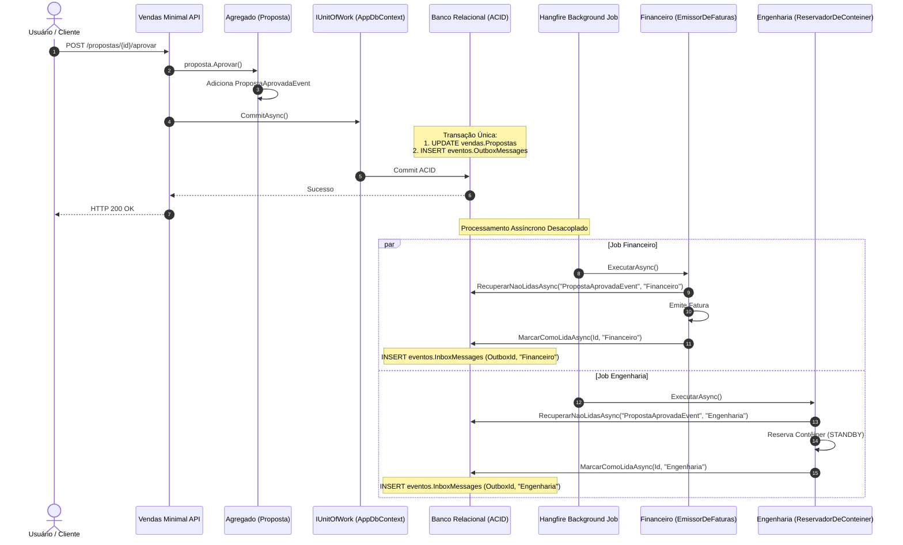

# Arquitetura do ContainerFlow (Monólito Modular com DDD em .NET 8)

Este documento detalha a arquitetura do **ContainerFlow**, um sistema para gestão e locação de contêineres construído com os princípios de **Domain-Driven Design (DDD)**, **Modular Monolith**, **Transactional Outbox/Inbox** e **Event-Driven Architecture (EDA)** no ecossistema .NET 8.

---

## 1. Visão Geral da Arquitetura

O sistema adota o padrão **Monólito Modular**, combinando a simplicidade de implantação de uma aplicação única com a estrita separação de fronteiras de domínio (Bounded Contexts), permitindo a futura migração para microsserviços se necessário.

```mermaid
graph TD
    %% Estilos Globais
    classDef hostStyle fill:#1e293b,stroke:#38bdf8,stroke-width:2px,color:#f8fafc;
    classDef coreStyle fill:#334155,stroke:#94a3b8,stroke-width:1px,color:#f8fafc;
    classDef contextStyle fill:#0f172a,stroke:#6366f1,stroke-width:2px,color:#f8fafc;
    classDef entityStyle fill:#1e1b4b,stroke:#818cf8,stroke-dasharray: 3 3,color:#e0e7ff;
    classDef eventStyle fill:#701a75,stroke:#f472b6,stroke-width:1.5px,color:#fdf2f8;
    classDef dbStyle fill:#064e3b,stroke:#34d399,stroke-width:2px,color:#ecfdf5;

    %% Entrypoint / Host
    subgraph Host ["Host e Infraestrutura (ContainerFlow.API)"]
        API["REST Endpoints / Minimal APIs"]:::hostStyle
        CompositionRoot["Modular DI Extensions\n(Clientes, Vendas, Engenharia, Financeiro)"]:::hostStyle
        DbContext["AppDbContext (Unit of Work + Interceptor Outbox)"]:::hostStyle
        EvManager["EventoManager (Outbox & Inbox Handler)"]:::hostStyle
        Hangfire["Hangfire Recurring Jobs\n(EmissorDeFaturas & ReservadorDeConteiner)"]:::hostStyle
    end

    %% Core & Abstrações
    subgraph SharedKernel ["Shared Kernel e Building Blocks"]
        DDD["ContainerFlow.DDD\n(IAggregateRoot, Entity, IDomainEvent, DomainException)"]:::coreStyle
        Contracts["ContainerFlow.Contracts\n(IUnitOfWork, IRepository Semânticos, IEventoManager)"]:::coreStyle
    end

    %% Bounded Contexts
    subgraph Contexts ["Bounded Contexts (Core Business)"]
        
        subgraph ClientesContext ["Contexto: Clientes"]
            ClienteAggr["Agregado: Cliente\n(IClienteRepository, Endpoints)"]:::entityStyle
        end

        subgraph VendasContext ["Contexto: Vendas"]
            PropostaAggr["Agregado: Proposta"]:::entityStyle
            PedidoAggr["Agregado: PedidoLocacao"]:::entityStyle
            LocacaoAggr["Agregado: Locacao"]:::entityStyle
            EvPropostaAprovada["Integration Event:\nPropostaAprovadaEvent"]:::eventStyle
            PropostaAggr -->|Dispara ao Aprovar| EvPropostaAprovada
        end

        subgraph EngenhariaContext ["Contexto: Engenharia"]
            ContainerAggr["Agregado: Conteiner"]:::entityStyle
            Reservador["Background Consumer:\nReservadorDeConteiner"]:::eventStyle
        end

        subgraph FinanceiroContext ["Contexto: Financeiro"]
            FaturaAggr["Agregado: Fatura"]:::entityStyle
            Emissor["Background Consumer:\nEmissorDeFaturas"]:::eventStyle
        end
    end

    %% Persistência & Schemas Segregados
    subgraph Database ["Database (Schematized Modular Storage)"]
        SchemaVendas[("Schema: vendas\n(Propostas, Pedidos, Locacoes)")]:::dbStyle
        SchemaEng[("Schema: engenharia\n(Conteineres, Tipos)")]:::dbStyle
        SchemaFin[("Schema: financeiro\n(Faturas)")]:::dbStyle
        SchemaClientes[("Schema: clientes\n(Clientes)")]:::dbStyle
        TableOutbox[("Schema: eventos\nTable: OutboxMessages")]:::dbStyle
        TableInbox[("Schema: eventos\nTable: InboxMessages")]:::dbStyle
    end

    %% Relacionamentos de Dependência
    ClientesContext -.-> DDD
    VendasContext -.-> DDD
    EngenhariaContext -.-> DDD
    FinanceiroContext -.-> DDD
    VendasContext -.-> Contracts
    EngenhariaContext -.-> Contracts
    FinanceiroContext -.-> Contracts

    %% Fluxo de Gravação Atômica
    VendasContext -->|IUnitOfWork.CommitAsync()| DbContext
    DbContext -->|Gravação ACID 1| SchemaVendas
    DbContext -->|Gravação ACID 2: Interceptor Outbox| TableOutbox

    %% Mecanismo Assíncrono Idempotente
    Hangfire -->|Executa periodicamente| Reservador
    Hangfire -->|Executa periodicamente| Emissor
    
    Reservador -->|RecuperarNaoLidasAsync| EvManager
    Emissor -->|RecuperarNaoLidasAsync| EvManager
    EvManager -->|Verifica Inbox e Marca Como Lida| TableInbox
    
    Reservador -->|Reserva Conteiner no Standby| ContainerAggr
    Emissor -->|Emite Fatura Inicial| FaturaAggr
```

---

## 2. Componentes e Estrutura de Camadas

| Projeto | Camada / Papel | Responsabilidade |
| :--- | :--- | :--- |
| **`ContainerFlow.DDD`** | Shared Kernel | Primitivas de domínio base: `Entity<TId>`, `AggregateRoot<TId>`, `IDomainEvent`, `DomainEvent`, `DomainException`, `IAggregateRoot`. |
| **`ContainerFlow.Contracts`** | Contratos & Abstrações | Interfaces de repositórios semânticos (`IClienteRepository`, `IPropostaRepository`, `IConteinerRepository`, etc.), `IUnitOfWork`, `IEventoManager`, eventos de integração (`PropostaAprovadaEvent`). |
| **`ContainerFlow.Clientes`** | Bounded Context | Gestão de clientes, limites cadastrais e regras cadastrais. Expõe `ClientesModuleExtensions`. |
| **`ContainerFlow.Engenharia`** | Bounded Context | Gestão de ciclo de vida dos contêineres, manutenções e consumidor `ReservadorDeConteiner`. Expõe `EngenhariaModuleExtensions`. |
| **`ContainerFlow.Financeiro`** | Bounded Context | Faturamento, conciliação e consumidor `EmissorDeFaturas`. Expõe `FinanceiroModuleExtensions`. |
| **`ContainerFlow.Vendas`** | Bounded Context | Propostas comerciais, pedidos de locação, cálculo de prazos e locações. Expõe `VendasModuleExtensions`. |
| **`ContainerFlow.API`** | Composition Root / Host | Configuração modular de DI, roteamento das Minimal APIs, middleware RFC 7807 `ProblemDetails`, agendamento de jobs Hangfire e infraestrutura do EF Core (`AppDbContext`). |

---

## 3. Padrão Transactional Outbox e Inbox Multi-Reader

Para resolver o problema de **Dual-Write** sem necessitar de transações distribuídas (2PC / DTC), o sistema utiliza o padrão **Transactional Outbox** com consumo idempotente via **Inbox**:

### 3.1. Publicação Atômica (Outbox)
1. Durante a execução de um comando no domínio (ex: `proposta.Aprovar()`), o agregado registra o evento `PropostaAprovadaEvent` na sua coleção interna de eventos.
2. Ao invocar `IUnitOfWork.CommitAsync()` / `AppDbContext.SaveChangesAsync()`, o contexto intercepta as entidades rastreadas que implementam `IAggregateRoot`.
3. Os eventos são serializados em JSON e gravados na tabela `eventos.OutboxMessages` na **mesma transação ACID** que atualiza o estado do agregado.
4. Após o commit bem-sucedido no banco, o `AppDbContext` limpa a lista de eventos dos agregados.

### 3.2. Consumo Idempotente (Inbox Multi-Reader)
1. Cada consumidor (`ReservadorDeConteiner` da Engenharia, `EmissorDeFaturas` do Financeiro) busca eventos não processados especificando seu identificador (`TipoLeitor`).
2. A consulta filtra registros da `OutboxMessages` que ainda não possuem registro correspondente em `InboxMessages` para aquele `TipoLeitor`.
3. O `EventoManager` processa o payload e insere o registro na tabela `eventos.InboxMessages` de forma atômica e idempotente.



---

## 4. Repositórios Semânticos e Unit of Work

Para evitar vazamento de consultas genéricas e acoplamento entre contextos:
- Todas as operações de persistência utilizam interfaces semânticas explícitas:
  - `IClienteRepository`
  - `IPropostaRepository`
  - `ISolicitacaoRepository`
  - `ILocacaoRepository`
  - `IConteinerRepository`
  - `IFaturaRepository`
- A transacionalidade é orquestrada através da abstração `IUnitOfWork`, eliminando o uso de `TransactionScope` e garantindo transações ACID locais nativas do EF Core.

---

## 5. Schemas de Banco de Dados Segregados

Para garantir o isolamento dos dados e preparar o monólito para eventual extração de microserviços:

- **`clientes.*`**: Tabela `Clientes`
- **`engenharia.*`**: Tabelas `Conteineres`, `TiposConteiner`
- **`financeiro.*`**: Tabela `Faturas`
- **`vendas.*`**: Tabelas `Propostas`, `PedidosLocacao`, `Locacoes`, `Comentarios`, `Enderecos`
- **`eventos.*`**: Tabelas `OutboxMessages`, `InboxMessages`

---

## 6. Cobertura de Testes Automatizados

A suíte de testes unitários e de integração (`ContainerFlow.Testes`) cobre:

1. **`EventosTestes`**: Persistência no Outbox, recuperação idempotente no Inbox e deduplicação de mensagens lidas.
2. **`RepositoriosTestes`**: Operações CRUD e transações ACID via `IUnitOfWork` com repositórios semânticos.
3. **`ConsumersTestes`**: Processamento de eventos de integração por múltiplos leitores (`EmissorDeFaturas` e `ReservadorDeConteiner`).
4. **`DomainInvariantesTestes`**: Máquinas de estado e invariantes dos agregados (`Proposta`, `Conteiner`, `PedidoLocacao`, `CalculadoraPadraoPrazosLocacao`).
